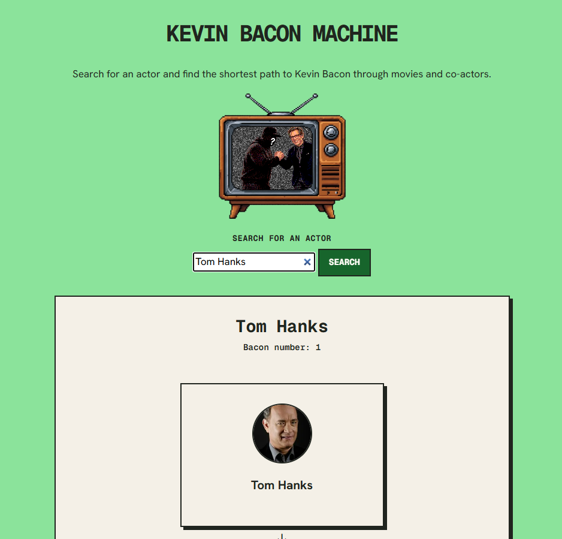
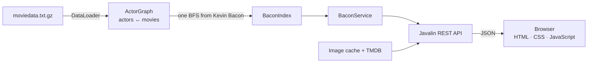

# Kevin Bacon Machine

Find the shortest path from any actor to Kevin Bacon, through the movies they have shared.



Type a name such as *Tom Hanks* and the app shows the actor's **Bacon number** and the chain of co-stars and movies that leads to Kevin Bacon:

```
Zlatan Ibrahimovic → Les arbitres (2009) → Horst Köhler → Der Geist des Geldes (2007) → Tom Cruise → A Few Good Men (1992) → Kevin Bacon
```

The full dataset holds **2.8 million actors and 811,000 movies**. After start-up, every search takes less than a millisecond.

## Features

- Shortest path from any actor to Kevin Bacon, drawn step by step in the browser
- Actor photos from TMDB, bundled as a cache so that **no API key is needed**
- Downloads the full dataset automatically on first run; ships with a small demo dataset
- No database or external services required: a single runnable jar

## How it works



**The graph.** Actors and movies form a bipartite graph: two actors are connected if they appear in the same movie. The data file is parsed into `Actor` and `Movie` objects that reference each other.

**The search.** A simple approach runs a breadth-first search from the searched actor towards Kevin Bacon for every query. On 2.8 million actors that takes up to a second per search. Instead, `BaconIndex` runs **one BFS from Kevin Bacon when the server starts** (about 1.5 s). Because the graph is undirected, the BFS tree records each actor's distance to Bacon and the neighbour one step closer. Answering a query then only means following those parent pointers: **O(path length) instead of O(V + E)**.

**Memory.** The BFS state is stored in plain `int[]` arrays indexed by actor id rather than in hash maps. Lookup tables that are only needed while parsing are released afterwards. The full graph fits in about 1 GB of heap.

**Images without an API key.** TMDB serves images from a public CDN, but finding *which* image belongs to an actor requires an API call. The `ImageCacheBuilder` tool looks these up once and stores them in `actor-images.tsv`, which is bundled with the app. It covers the actors who appear in most paths: Kevin Bacon's co-stars (the last step of every path) and the most prolific actors (the hubs that paths pass through). If you add your own TMDB token, other actors are looked up live.

## Getting started

**Requirements:** Java 21+ and Maven 3.9+.

```bash
git clone https://github.com/DanZavodnik/kevin-bacon-machine.git
cd kevin-bacon-machine
mvn package
java -Xmx2g -jar target/kevin-bacon-machine.jar
```

The browser opens at <http://localhost:8080>.

On the **first run**, the full dataset (~110 MB) is downloaded from this repository's [releases](../../releases) to `data/`. Later runs start straight from that file; loading takes 20–30 seconds.

To try it instantly with the small bundled dataset:

```bash
java -jar target/kevin-bacon-machine.jar --demo
```

You can also run it without building the jar: `mvn compile exec:java` (or add `-Dexec.args="--demo"`).

### Configuration

All settings are optional. Set them as environment variables or in a `.env` file (copy `.env.example`).

| Variable | Default | Description |
| --- | --- | --- |
| `PORT` | `8080` | Port for the web server |
| `TMDB_TOKEN` | – | TMDB API Read Access Token, for live images of actors outside the bundled cache |
| `DATA_FILE` | – | Load a local data file (`.txt` or `.txt.gz`) instead of downloading |
| `DATASET` | – | Set to `demo` to always use the bundled demo dataset |
| `DATASET_URL` | latest release | Where to download the full dataset from |

Command-line flags: `--demo` (bundled dataset) and `--no-browser` (don't open a browser tab).

## API

| Endpoint | Returns |
| --- | --- |
| `GET /api/bacon?actor=Kevin%20Hart` | JSON list with name, Bacon number and path for every actor with that name |
| `GET /api/actor-image?name=Kevin%20Hart` | Image URL as plain text, or `404` |
| `GET /api/stats` | Number of actors and movies in the loaded dataset |

## Project structure

```
src/main/java/se/zavodnik/bacon/
├── App.java              start-up: load data, build index, start server
├── config/EnvConfig      settings from environment variables or .env
├── data/                 DataLoader (parser), Dataset (download + demo fallback)
├── model/                Actor, Movie, ActorGraph
├── search/               BaconIndex (BFS), BaconService, result types
├── images/               image cache, TMDB client, ImageCacheBuilder
└── web/WebServer         Javalin routes and static files
src/main/resources/
├── public/               frontend (HTML, CSS, JavaScript)
├── data/                 demo dataset
└── images/               bundled actor image cache
```

## Tests

```bash
mvn test
```

The unit tests cover parsing of the data format, shortest paths and unreachable actors in the BFS index, name normalisation in the search, the image cache and the `.env` parser.

## Updating the image cache

Requires a TMDB token in `.env`:

```bash
mvn -q compile exec:java -Dexec.mainClass=se.zavodnik.bacon.images.ImageCacheBuilder -Dexec.args="20000"
```

The argument is the number of most prolific actors to include. The tool respects TMDB's rate limit and can be stopped and resumed.

## Background

The project started as a console program in a course on algorithms and data structures at Stockholm University. It was later rebuilt as a web application with a Java backend and a JavaScript frontend.

## Data and attribution

- Movie and cast data: derived from the plain-text data files that IMDb published for personal and non-commercial use.
- Actor images: [The Movie Database (TMDB)](https://www.themoviedb.org/). This product uses the TMDB API but is not endorsed or certified by TMDB.
- Fonts: [Geist Mono](https://fonts.google.com/specimen/Geist+Mono) and [Hanken Grotesk](https://fonts.google.com/specimen/Hanken+Grotesk), SIL Open Font License.

## License

Code released under the [MIT License](LICENSE). The data and images are subject to their own terms, listed above.
